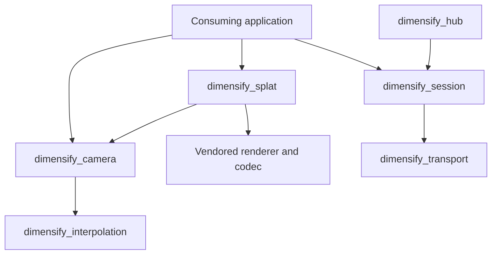

# Architecture

Dimensify provides independently usable viewer and collaboration packages.
Applications select the packages they need and compose their own runtime.
The active workspace manifest, rather than the presence of an old source file,
defines the supported package graph.

## Active packages

| Package | Responsibility |
| --- | --- |
| `dimensify` | Core camera setup and compatibility types; optional native URDF kinematic viewer and splat viewer example |
| `dimensify_camera` | Camera poses, framing, transitions, Fly/Walk response and optional inspect controller; hosts retain input capture, environment queries and the final transform writer |
| `dimensify_interpolation` | Bounded interpolation queue used by camera transitions |
| `dimensify_splat` | Manifest and LOD policy, optional loading/rendering, streamed scheduling/cache/residency, renderer-ready handoff and quality observations |
| `dimensify_ui` | Camera markers and a no-op compatibility plugin; applications compose their UI separately |
| `dimensify_transport` | WebSocket/WebTransport connections, fallback, cancellation and listeners |
| `dimensify_session` | Registered document/presence channels, schema handshake, room authority, roles, invitations and private resume |
| `dimensify_hub` | Headless session hosting, bind/TLS configuration and optional HTTP readiness ingress |

The [examples guide](examples.md) lists runnable consumers and focused checks.
The [collaboration guide](collaboration.md) owns room semantics, hosting and
network verification procedures.

These are ownership edges, not a mandatory plugin group. A headless room host
has no renderer, window, robot or physics dependency. Camera pose helpers and
splat policy can also be consumed without installing an interactive viewer.
The [isolated export check](../scripts/verify-standalone.py) verifies package
resolution outside this checkout and rejects graphics/robot dependencies in
the headless host graph.

## Viewer composition

`dimensify_camera` computes reusable camera behavior. The consuming application
owns device input capture, focus and UI suppression, scene queries, mode selection
and the single writer of the final camera transform. The splat example already
uses shared inspect and Fly helpers. The robot viewer uses the same inspect
controller, owned drag mapping and bounds union, with one final camera writer
after robot transforms propagate. Full device and mode composition remains
separate work; shared camera math does not imply every viewer has the same
controls yet.

`dimensify_splat` has distinct optional layers:

- With default features disabled: manifest parsing and LOD policy without a renderer.
- `render`: whole-file loading and integration with the vendored Gaussian renderer.
- `streaming`: source resolution, worker decoding, scheduling, cache/budget
  admission, snapshot/resident/packed adapters and renderer-ready activation.
- `viewer`: standalone native/WebGPU composition with shared Feathers UI and
  small platform file/URL adapters. It selects WebGPU and SH3.

Custom consumers select renderer backends explicitly. The streaming library
supports the existing WebGPU and WebGL integrations; the standalone viewer
currently targets WebGPU. See [splat viewer](splat-viewer.md) for supported
inputs, native/WASM commands and quality-report APIs.

Quality observations and bounded leaf evidence belong to the library. Named
presets, persistence, appearance warnings and application panels belong to the
host. Shared quality panels remain unfinished. Vendored renderer, codec and
sorter changes stay under their existing provenance/patch ownership; there is
one shared implementation rather than a second renderer inside an application.

## Collaboration composition

Transport delivers connections and packets. Session owns room membership,
registered projections, write policy enforcement and document revisions. Hub
composes the session authority with listeners. Applications supply document
schemas, domain validation, identity integration, asset authorization and UI.
Camera presentation sharing is opt-in through session registration.

!!! note "Rooms do not authorize assets"
    An invite grants room participation under its role. It does not grant
    access to files, signed resources or provider credentials referenced by a
    shared document. The consuming application owns those decisions.

The active system is server-authoritative, memory-only document collaboration.
Discovery/matchmaking, WebRTC/P2P, durable rooms and host migration remain future
work. Reliable ordered session messages are not an implemented replayable
simulation stream or general ECS replication API.

## Application boundary

Reusable behavior belongs here when a neutral API and an independent example
or focused test can demonstrate it. Consumers retain provider discovery and
authentication, project admission, domain workflows, product presets, branding,
embedding protocols and shell presentation. Adapters translate between these
concerns and shared resources/intents without copying the underlying controller.

Keep optional packages independent: a camera consumer should not acquire robot
or session dependencies; a collaboration host should not acquire a renderer.
New domain requirements should not silently expand a foundational dependency
or add product policy to a shared transport or loader.

## Planned simulation and excluded prototypes

The native robot viewer currently performs kinematics. Dynamics/collision
simulation, browser-local URDF simulation, a supported Python launch/attach API,
ordered scene command streams and simulation telemetry remain planned work.
No current core feature flag installs a physics backend.

The workspace excludes `crates/protocol`, `crates/component_derive`,
`crates/widgets`, `python` and `legacy/transport`. Their source and old environment
variables are prototype references, not active APIs. The
[protocol design](protocol.md) describes that earlier design; it must not be used
as a current networking or launch guide. Old UI/editor source outside the active
module tree does not constitute a supported UI package.

The [migration checklist](../docs-dev/migration-checklist.md) tracks accepted
extractions and unfinished work. New simulation/backend work should establish
its own supported contract and independent checks before reviving prototypes.
