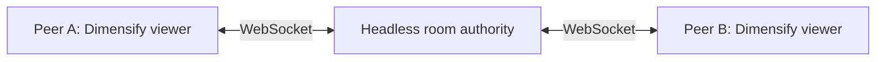

# Examples and tests

Run these commands from the Dimensify workspace root. Each active crate has a
small runnable consumer, with deeper tests where the crate owns behavior.
The browser [example gallery](../splat-web/gallery/index.html) catalogs live, native
and headless demonstrations. Serve `splat-web/` and open `/gallery/`;
[the browser build instructions](splat-viewer.md#browser) also build its live viewer.
The excluded protocol, Python, widgets, derive and legacy transport prototypes
are not supported by these commands.

| Crate | Runnable example | What it demonstrates |
| --- | --- | --- |
| `dimensify` | `cargo run --locked -p dimensify --example camera_setup` | Create and query the primary viewer camera without a window or GPU |
| `dimensify_camera` | `cargo run --locked -p dimensify_camera --features inspect --example inspect_camera` | Headless shared orbit/pan/zoom; also see `frame_bounds`, `fly_camera` and `walk_camera` |
| `dimensify_interpolation` | `cargo run --locked -p dimensify_interpolation --example cursor_playback` | Bounded ordered cursor samples interpolated on the render clock |
| `dimensify_splat` | `cargo run --locked -p dimensify --features splat --example splat_viewer` | Native/WebGPU file/URL loading, streamed hierarchy, camera controls and touch gestures |
| `dimensify_ui` | `cargo run --locked -p dimensify_ui --example camera_markers` | Keep scene and overlay camera ownership separate |
| `dimensify_transport` | `cargo run --locked -p dimensify_transport --example endpoint` | Validate and normalize an endpoint without opening a socket |
| `dimensify_session` | `just collab-check` | Two headless clients create/join, edit, exchange presence, resume and leave through a running host |
| `dimensify_hub` | `just collab-server` | Run a standalone headless shared-cube authority |

The vendored `sog_codec` and `splat_sort` helpers have focused unit tests rather
than separate application UIs. Run `cargo test --locked -p sog_codec` and
`cargo test --locked -p splat_sort` for their decode/sort contracts.

The gallery's browser cards open real WASM examples. Native and headless cards
show commands and source paths; they do not imply a browser implementation.
Collaboration cards require a separately running host. Robot dynamics and a
browser robot viewer remain planned.

## Automatic gallery and browser builds

```sh
just showcase-build
python3 -m http.server 8080 --directory splat-web
```

Open `/gallery/`. The build discovers Cargo examples, compiles every browser
entry, runs wasm-bindgen and packages required worker assets. Cargo reuses
unchanged compiler outputs. It does not publish or deploy the site.

Every new workspace example appears automatically. Runtime support cannot be
inferred from a Rust filename: unclassified examples appear as local commands.
Opt into browser building in the owning crate's manifest:

```toml
[[package.metadata.showcase]]
target = "camera_playground"
title = "Camera playground"
browser = true
features = ["playground"]
description = "Try orbit, fly and touch controls over a simple scene."
note = "Requires WebGPU. Runs entirely in the browser."
```

The Rust target must exist and configure its WASM window with
`canvas: Some("#dimensify-canvas".into())` and `fit_canvas_to_parent: true`.
Its generated page and WASM assets live under `splat-web/examples/`; no gallery
JavaScript edit or handwritten HTML is needed. Add `targets = ["headless"]` or
`targets = ["native"]` to classify other examples. Binaries require an explicit
metadata entry with `kind = "bin"`.

Use `just showcase-catalog` to refresh cards without compiling,
`python3 scripts/showcase.py --check` for freshness checks, and
`just showcase-build --only ID` for an incremental browser build. The isolated
export check validates catalog freshness too. Browser builds need the matching
wasm-bindgen CLI and the WASM Rust target described in the viewer build guide.
The build command discovers new entries each run; it is not a file watcher.

## Interactive browser examples

After `just showcase-build`, use the gallery's Browser filter:

- **Camera playground:** a built-in scene with shared Orbit/Fly, Frame, Reset,
  mouse and touch controls. No upload or room server is needed.
- **Gaussian splat viewer:** local files, URLs and streamed SOG hierarchies.
- **Browser collaboration:** create a room and use **Editor tab** or **Viewer tab**
  to join it through a short invite code. **Color** and **Move** submit edits;
  **Explore/Follow** switches local navigation and presenter following. The
  status shows acknowledged role, participant count, revision and errors.
  **Connection** opens the same Feathers form on native and WASM: enter a host
  URL and display name, then **Create**, or enter an invite code and **Join**.
  **Retry** repeats the last submitted attempt and resumes the participant when
  its private credential is still valid. Invalid form input preserves the active
  room. **Close** or Escape dismisses the panel and returns camera input.

For collaboration, run `just collab-server` first. The default endpoint is
`ws://127.0.0.1:5002`; use `?endpoint=wss%3A%2F%2FHOST` on the example URL for a
different reachable host, or change it through **Connection** without reloading.
Join links carry only endpoint, invite code and display
name. Pop-up blocking may require allowing the new-tab action. The creator also
shows the short editor/viewer codes. A browser page served over HTTPS needs a
secure WebSocket endpoint. This demo shares a document and presentation; it does
not run robot dynamics or expose a public room service.

Both examples also run natively through their catalog commands. Their rendered
controls are the same retained Feathers UI. The example shell reuses the optional
shared navigation adapter rather than maintaining another camera controller.

Headless browser verification against a running static site and authority:

```sh
node scripts/check-showcase-browser.cjs http://localhost:8080/ ws://127.0.0.1:5002
```

Set `PLAYWRIGHT_MODULE` or `CHROMIUM_EXECUTABLE` to use an existing installation,
as described in [collaboration verification](collaboration.md#verification).

The transport example accepts an optional URL argument after `--`; invalid URLs
exit unsuccessfully. The viewer also has the optional [RoboSim application](../README.md#run-robosim).

## Choose a collaboration example

| Example | Join method | Use it for |
| --- | --- | --- |
| `shared_cube` | Endpoint + room ID + invitation token | Explicit connection credentials in a graphical app |
| `shared_cube_invite` | Endpoint + short invite code | Human-friendly sharing in the same graphical app |
| `session_check` | Automatically creates and joins with an editor code | Headless native/WASM synchronization and reconnect checks |

Both graphical examples use the same cube, camera and cursor adapters. A code
selects the room and permission on its issuing server; the optional name only
sets the participant's display name.

## Connect two Dimensify viewers with raw tokens

This example composes the real `DimensifyPlugins` camera with session document,
presentation and cursor adapters. It lives in the session crate's examples so
the core viewer has no networking dependency.



1. In terminal 1, start the host:

   ```sh
   just collab-server
   ```

2. In terminal 2, create a room with the first viewer:

   ```sh
   just collab-peer
   ```

3. Once connected, it prints two join commands. Copy the **editor** command
   into terminal 3. This opens a second, independent Dimensify viewer in the
   same room. Use the viewer invitation instead for a read-only participant.

   The equivalent recipe is:

   ```sh
   just collab-peer ws://127.0.0.1:5002 ROOM INVITATION guest
   ```

   Replace `ROOM` and `INVITATION` with the values printed by the first peer.
   Starting `collab-peer` twice without those values creates two separate rooms.

Both windows should show two participants and the same cube. Press **Space** to
change its color or **X** to move it; the other peer should show the edit and
the same document revision. The room creator initially presents: use its arrow
keys to orbit and the second peer follows. Arrows in the second peer detach
its local camera; **F** follows again. **P** requests presentation, **G** grants
the first request, and **R** claims presentation after the presenter leaves.
Cursors appear for peers sharing the presentation view.

!!! note "Connection model"
    These are two client peers connected through an authoritative server. The
    server must remain running. Direct WebRTC peer-to-peer connections, NAT
    traversal and host migration are future work. Only registered cube state,
    presentation and cursor channels synchronize; arbitrary ECS entities do not.

For two machines on a trusted LAN, start the host with
`DIMENSIFY_COLLAB_BIND=0.0.0.0:5002` and give both clients
`ws://HOST_LAN_IP:5002`. Invitation values grant room access; share them only
with intended participants. See [hosting](collaboration.md#hosting-and-transport)
for secure remote endpoints and TLS options.

## Connect two viewers with short invite codes

Start the same server with `just collab-server`, then create a room:

```sh
cargo run --locked -p dimensify_session --features example-dimensify --example shared_cube_invite
```

The host prints separate viewer and editor join commands. Copy one into another
terminal. Their form is:

```sh
cargo run --locked -p dimensify_session --features example-dimensify --example shared_cube_invite -- ws://127.0.0.1:5002 CODE guest
```

Replace `CODE` with a printed code (formatted like `ABCD-EFGH-JKMN`). No room ID
or long token is needed. To host at another endpoint, supply only the endpoint;
to join, supply that same endpoint and its code. Controls match the raw-token
example above, and both examples can participate in rooms on the same server.

!!! note "Code lifetime"
    Codes grant viewer or editor access and expire after 24 hours. They are scoped
    to the issuing server and room lifetime. The session API supports owner renewal;
    this small graphical example does not expose a renewal control.

## Verify without visible windows

```sh
just tests
```

This runs the active workspace's camera, endpoint, session and hub suites,
including real local network and HTTP tests. UI camera-marker usage is covered
by its runnable example above. To exercise two headless clients against the
server from terminal 1:

```sh
just collab-check ws://127.0.0.1:5002
```

It exits successfully only after both clients observe the edit and presence,
and the reconnect preserves identity. This checks state, not rendered pixels.
The graphical example also has an opt-in offscreen test:

```sh
cargo test --locked -p dimensify_session --features server,example-dimensify --example shared_cube
cargo test --locked -p dimensify_session --features server,example-dimensify --example shared_cube two_dimensify_clients_render_edit_follow_and_resume -- --ignored --test-threads=1
```

The second command requires a GPU but creates no visible OS window. It writes
captures under `target/collaboration-acceptance`, or `DIMENSIFY_ACCEPTANCE_DIR`
if set. Browser verification uses the separate
[WASM session check](collaboration.md#verification); the graphical CLI here is native.

## Gaussian PLY and SOG files

Run the standalone [splat viewer](splat-viewer.md) with Open File and drop support:

```sh
cargo run --locked -p dimensify --features splat --example splat_viewer
```

Its reusable crate also has focused decoding and scene replacement tests:

```sh
cargo test --locked -p dimensify_splat --lib --tests
```
