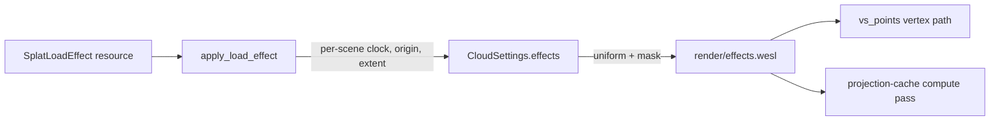

# Gaussian load effects

Opt-in per-splat animations that play once when a scene first becomes visible.
They are cosmetic: a finished effect renders exactly like the unanimated cloud.

| Effect | Look |
| --- | --- |
| `reveal` | A glowing front sweeps outward from the origin. Ahead of it, splats are dim pixel-sized sparkles; behind it, they settle into place. |
| `explosion` | Splats burst out of the origin along staggered arcs and grow into place. |
| `reveal-explosion` | Both stages composed: the burst lands while the front sweeps over it. |

Select one with the viewer's `--effect` argument, the browser `?effect=` query,
or **Settings > Rendering > Load effect**. **Replay** restarts the animation on
the current scene. The gallery has one preset per effect.

The origin is chosen with `--effect-origin`, `?effect_origin=` or
**Effect origin**:

| Origin | Reveal shape |
| --- | --- |
| `target` (default) | A sphere growing from the surface at the centre of the view. The viewer depth-picks it; elsewhere, or when picking is off, the point where the view ray crosses the scene bounds is used. |
| `camera` | A sphere growing around the camera position. The explosion streams splats out of the viewpoint. |
| `center` | A disc sweeping across the ground plane from the scene bounds centre. |

The depth pick draws the rest pose, so it finds the surface even while the
effect holds splats hidden; picking for pivots during an animation also hits
the final geometry. A camera or target origin waits for the camera to stop
moving (at most one second, plus half a second for the pick), so
the viewer's animated frame-on-load does not capture a pose mid-flight. The
origin then stays fixed for the rest of the animation; **Replay** recaptures
the current camera.

## How it works

- **Scene clock.** Streaming replaces cloud entities as generations hand off,
  so `apply_load_effect` keeps the clock, origin and extent per scene root and
  stamps them onto every current and pending cloud. The clock starts on the
  first frame a cloud under the root is visible (after the camera settles, for
  a camera origin). Origin and extent are then fixed; extent is the farthest
  weighted distance from the origin to the visible bounds.
- **Shader stage.** `render/effects.wesl` holds pure stage functions over a
  small `SplatEffect` (centre, footprint scale, opacity multiplier, emission).
  Every stage reads the splat's immutable rest position, so stages compose
  without feeding each other. A per-splat stagger hashes position bits rather
  than the index, so it survives source remapping.
- **Pipeline cost.** `SplatEffects::enabled` adds the `SPLAT_EFFECTS` shader
  def; the default pipeline is unchanged. Stages are then selected per frame by
  a uniform mask. Finished stages drop out of the mask, and the def stays on so
  completing an effect never triggers a pipeline compile.
- **Footprint.** Shrinking scales the projected covariance about its 0.3 px
  low-pass floor, so hidden splats become sparkles instead of vanishing.

## Adding a stage

1. Write `fn <name>_stage(rest, hash, effect) -> SplatEffect` in
   `vendor/bevy_gaussian_splatting/src/render/effects.wesl`, give it the next
   mask bit, and call it from `apply_effects`.
2. Add the bit, a flag and any parameters to `SplatEffects`
   (`src/gaussian/effects.rs`); append parameters to `GaussianUniforms` in
   `bindings.wesl` and `CloudUniform` in `render/mod.rs`.
3. Add a `LoadEffect` variant in `crates/splat/src/effects.rs`, plus a gallery
   preset in `site/gallery/launch.mjs`.

!!! warning "Limitations"
    - Only 3D Gaussians animate; 2D/4D clouds and the WebGL2 fallback ignore
      effects.
    - The radix sort keys use rest positions on the vertex path, so large
      displacements (explosion) can briefly show ordering errors under sorted
      transparency. The projection-cache path sorts the animated centres.
    - Detail that streams in after the animation finishes appears without an
      animation; per-chunk arrival effects are not implemented.
