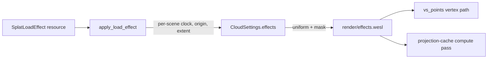

# Gaussian load effects

Opt-in per-splat animations that play once when a scene first becomes visible.
They are cosmetic: a finished effect renders exactly like the unanimated cloud.

| Effect | Look |
| --- | --- |
| `reveal` | A glowing front sweeps outward from the origin. Ahead of it, splats are dim pixel-sized sparkles; behind it, they settle into place. |
| `explosion` | Splats burst out of the origin along staggered arcs and grow into place. |
| `reveal-explosion` | Both stages composed: the burst lands while the front sweeps over it. |
| `magic` | After Spark's Magic reveal. A wipe circles the vertical axis through the origin, conjuring pixel-sized sparkles that drift on coherent noise behind a glowing hand; a glowing front then draws the surface in and settles them into splats. Only a hashed fifth of the unsettled splats sparkle, so dense scenes and their floaters do not fill the view with noise. |
| `magic-front` | Magic without the wipe: the glowing front grows outward from the origin straight away, over the same sparse sparkles. Suits large scenes, where the wipe shows the whole scene as sparkles first. |
| `stars` | After World Labs' homepage reveal. Ahead of a sphere growing from the origin on a cubic ease-in, splats are small pulsing points in their own colour (a fixed world size, not their footprint), drifting slowly, with 15% culled. The sphere cuts them hard into full splats, tinting a band just inside its edge with the glow colour. World Labs draw a low-res copy as the points and cut a high-res copy in; here one cloud plays both parts. |
| `spread` | After Spark's Spread reveal. The scene starts squeezed toward the origin and relaxes outward on an accelerating clock while one wide radial wave grows each splat from nothing to full size, fading it from grey to its colour. Spark uses three separate waves (grey dots, colour, full size); one continuous wave avoids their visible steps. |

Select one with the viewer's `--effect` argument, the browser `?effect=` query,
or **Settings > Rendering > Load effect**. **Replay** restarts the animation on
the current scene. The gallery has one preset per effect.

The origin is chosen with `--effect-origin`, `?effect_origin=` or
**Effect origin**:

| Origin | Reveal shape |
| --- | --- |
| `target` (default) | A sphere growing from the surface at the centre of the view. The viewer depth-picks it; elsewhere, or when picking is off, the point where the view ray crosses the scene bounds is used. |
| `camera` | A sphere growing around the camera position. The explosion streams splats out of the viewpoint. |
| `center` | A disc sweeping across the ground plane from the scene bounds centre. |

`magic`, `magic-front` and `spread` are ground-plane effects, as in Spark: whatever the
origin, they measure distance across the ground, so they sweep a disc around
the target, the camera or the centre rather than growing a sphere.

The depth pick draws the rest pose, so it finds the surface even while the
effect holds splats hidden; picking for pivots during an animation also hits
the final geometry. A camera or target origin waits for the camera to stop
moving (at most one second, plus half a second for the pick), so
the viewer's animated frame-on-load does not capture a pose mid-flight. The
origin then stays fixed for the rest of the animation; **Replay** recaptures
the current camera.

## Click ripples

Ripples are feedback rather than load effects: the viewer starts one where a
right-click lands on the splat surface (see [the viewer](splat-viewer.md)), and
hosts can start their own with `SplatRipples::spawn(origin, radius)`. A glowing
ring runs out to the radius, nudging and swelling splats as it passes; splats
at or past the radius are untouched. Up to four play at once (the oldest is
replaced), over any load effect, without extending its clock.

Ripples need the `SPLAT_EFFECTS` pipeline. The viewer arms it on the button
press so it compiles while the pick resolves, and while it compiles the cloud
keeps drawing with the plain pipeline instead of blanking. Load stages that
hide splats get no such fallback. Once the ripples finish, the cloud returns to
the plain pipeline, which stays cached, so later ripples switch without
compiling again.

## How it works

- **Scene clock.** Streaming replaces cloud entities as generations hand off,
  so `apply_load_effect` keeps the clock, origin and extent per scene root and
  stamps them onto every current and pending cloud. The clock starts on the
  first frame a cloud under the root is visible (after the camera settles, for
  a camera origin). Origin and extent are then fixed; extent is the farthest
  weighted distance from the origin to the visible bounds. For a target or
  camera origin it is capped at four look distances (camera to the looked-at
  point) past the near point, since floaters stretch bounds far beyond the
  framed scene. Splats beyond the cap settle with the last of the scene.
- **Shader stage.** `render/effects.wesl` holds pure stage functions over a
  small `SplatEffect` (centre, footprint scale, opacity multiplier, emission,
  grey-to-colour blend).
  Every stage reads the splat's immutable rest position, so stages compose
  without feeding each other. A per-splat stagger hashes position bits rather
  than the index, so it survives source remapping.
- **Pipeline cost.** `SplatEffects::enabled` adds the `SPLAT_EFFECTS` shader
  def; the default pipeline is unchanged. Stages are then selected per frame by
  a uniform mask. Finished stages drop out of the mask, and the def stays on so
  completing an effect never triggers a pipeline compile.
- **Footprint.** Shrinking scales the projected covariance about its 0.3 px
  low-pass floor, so hidden splats become sparkles instead of vanishing.

## Adding a stage

1. Write `fn <name>_stage(rest, hash, effect) -> SplatEffect` in
   `vendor/bevy_gaussian_splatting/src/render/effects.wesl`, give it the next
   mask bit, and call it from `apply_effects`.
2. Add the bit, a flag and any parameters to `SplatEffects`
   (`src/gaussian/effects.rs`); append parameters to `GaussianUniforms` in
   `bindings.wesl` and `CloudUniform` in `render/mod.rs`.
3. Add a `LoadEffect` variant in `crates/splat/src/effects.rs`, plus a gallery
   preset in `site/gallery/launch.mjs`.

!!! warning "Limitations"
    - Only 3D Gaussians animate; 2D/4D clouds and the WebGL2 fallback ignore
      effects.
    - The radix sort keys use rest positions on the vertex path, so large
      displacements (explosion, spread's squeeze) can briefly show ordering
      errors under sorted transparency. The projection-cache path sorts the animated centres.
    - Detail that streams in after the animation finishes appears without an
      animation; per-chunk arrival effects are not implemented.
