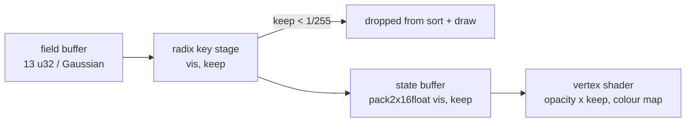

# Visibility fields

A visibility field records, for every Gaussian, the directions it was observed
from while the splat was trained. Its value is the probability that the Gaussian
was seen from about the current viewing direction. Content the capture never saw
from here gets a low value. Examples are the back of a wall filmed only from the
front, or a shelf seen from above when the camera only flew past it.

The renderer uses the field to:

- **fade** low-visibility Gaussians out, along a curve you control;
- **hide** them completely. They are removed from the sort and the draw, so they
  cost nothing;
- **show the uncertainty**, as a colour map or as an overlay on the regular render.

```bash
# The field is found next to the PLY at <dir>/visibility/visibility.safetensors
just splat-viewer path/to/splat.ply
just splat-viewer --visibility path/to/field.safetensors path/to/splat.ply
```

!!! note
    The field must be built for that exact PLY, with the same Gaussians in the
    same order. Whole-file PLY loading keeps the source order, but streamed or
    LOD-reordered SOG clouds do not, so fields are disabled for them. The field is
    evaluated in the radix sort, so the CPU sort shows the regular render.

## Controls

The "Visibility field" panel appears when a field is attached.

| control | key | effect |
|---|---|---|
| display | `V` | `off`, `faded`, `removed only` (what `faded` takes away), `uncertainty`, `overlay` |
| curve | `C` | `hide` (hard cut at the middle of the fade range), `smooth`, `linear` |
| fade start / end | `[` `]` move both, `-` `=` change the width | visibility below the start: removed; above the end: fully kept |
| curve exponent | `G`, `Shift+G` | values above 1 fade harder |
| rho | `,` `.` | share of the best direction's evidence needed for full visibility |
| evidence gain | | scales the absolute-evidence term |
| overlay strength | | how strongly `overlay` tints toward the uncertainty colour |

The opacity multiplier is `keep(vis)`. With `u = clamp((vis - lo) / (hi - lo))`:

| curve | keep |
|---|---|
| hide | `vis >= (lo + hi) / 2` |
| smooth | `smoothstep(u) ^ gamma` |
| linear | `u ^ gamma` |

A Gaussian whose resulting opacity is below 1/255 is skipped by the sort.
Visibility compaction is switched on while a field is active, so it is also left
out of the draw.

## File format

The file is a safetensors container:

| tensor | shape | meaning |
|---|---|---|
| `vis_sh` | `[N, (d+1)^2]` F16, `d <= 4` | real SH coefficients of the evidence `v(dir)` |
| `v_peak` | `[N]` F32 | maximum of `v` over the sphere |

The optional metadata key `field` holds JSON with `degree`, `rho`, `kappa` and
`n_views`.

The SH basis is gsplat's (Sloan 2013 ordering and signs). `dir` is the unit
direction from the camera to the Gaussian, in the cloud's local frame. The query
rule is:

```text
v   = SH(vis_sh, dir)
vis = (1 - exp(-gain * v)) * clamp(v / (rho * v_peak), 0, 1)
```

The first term is how much evidence there is in absolute terms. The second is the
share of the best direction's evidence. It keeps SH truncation ripple from
counting as observations from behind.

## Implementation



- **Storage.** Each Gaussian takes 52 bytes: the 25 SH coefficients plus `v_peak`,
  as 26 halves. 3M Gaussians use 156 MB.
- **Evaluation.** The radix key stage evaluates the field once per Gaussian per
  sort (`candidate_key`) and writes `vis` and `keep` to a per-cloud state buffer.
  The vertex shader reads that buffer.
- **Bindings.** These add three bindings: field and state on the radix sort group,
  and state on the draw's sorted-entries group. The radix compute stage stays
  within WebGPU's 8-storage-buffer baseline. Clouds without a field bind small
  fallback buffers, and `vis_mode = 0` skips every visibility branch.
- **Tests.**
  - `crates/splat/tests/visibility_field.rs` checks the basis and the query rule
    against gsplat golden vectors from `tools/visibility/vis_golden.py`.
  - `DIMENSIFY_VISIBILITY_SHOTS=<dir>` makes the native viewer save one screenshot
    per view and display mode, then exit.
